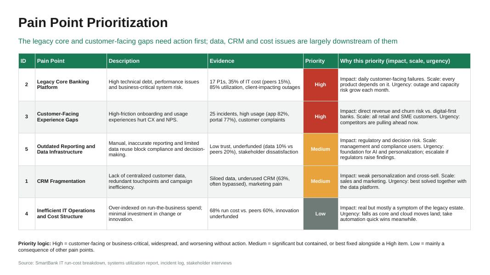
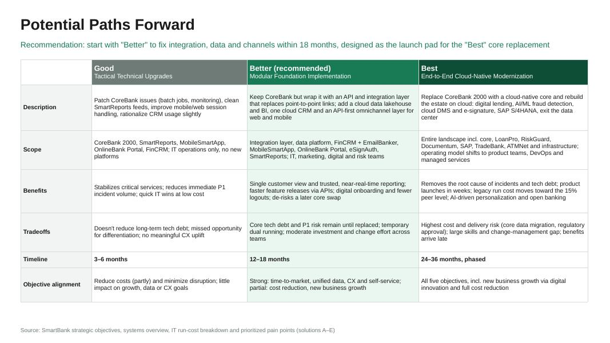
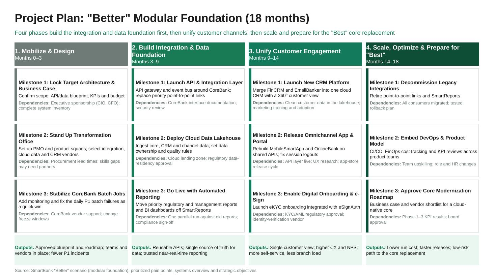

# BCG IT Architecture Job Simulation (Forage)

My solutions to the [BCG IT Architecture job simulation](https://www.theforage.com/simulations/bcg/it-architect-wjf1). The client is **SmartBank**, a mid-sized bank whose IT estate is legacy-heavy and on-premise. The work moves from assessment through prioritization and future-state design to a delivery plan.

| Task | Deliverable |
|---|---|
| 1. Client overview & initial assessment | [`SmartBank_Initial_Assessment.md`](task1-client-assessment/SmartBank_Initial_Assessment.md) |
| 2. Prioritize key pain points | [`SmartBank_Pain_Point_Prioritization.pptx`](task2-pain-point-prioritization/) |
| 3. Design future-ready solutions | [`SmartBank_Future_Architecture_Scenarios.pptx`](task3-future-state-scenarios/) |
| 4. Build the project plan | [`SmartBank_Project_Plan.pptx`](task4-project-plan/) |

Each slide folder also has a PDF export, a preview image and the `slide.js` source that generates the slide with [PptxGenJS](https://gitbrent.github.io/PptxGenJS/).

## Task 1 — Initial assessment
- 14 of 15 systems run on-premise.
- Legacy maintenance takes 35% of IT spend, against 15% for peers.
- CoreBank 2000 runs at 85% utilization and has daily P1 batch failures.
- Data and security spending are well below peers.
- CRM and reporting are fragmented and under-used.

## Task 2 — Pain point prioritization
| Priority | Pain point |
|---|---|
| High | Legacy core banking platform |
| High | Customer-facing experience gaps |
| Medium | Outdated reporting and data infrastructure |
| Medium | CRM fragmentation |
| Low | Inefficient IT operations and cost structure (mostly a symptom of the legacy estate) |



## Task 3 — Future-state scenarios (Good / Better / Best)
- **Good:** tactical technical upgrades, 3–6 months.
- **Better (recommended):** a modular foundation, 12–18 months. It adds an API/integration layer around the core, a cloud data lakehouse and BI, one cloud CRM, and API-first omnichannel apps.
- **Best:** end-to-end cloud-native modernization including a new core, 24–36 months.

"Better" delivers most of the strategic objectives within 18 months. It also lowers the risk of a later core replacement.



## Task 4 — Project plan for "Better"
The plan has four phases with three milestones each. Every milestone lists its dependencies, and every phase lists its outputs.
1. **Mobilize & Design** (months 0–3): blueprint and business case, transformation office, CoreBank batch stabilization.
2. **Build Integration & Data Foundation** (months 3–9): API layer, cloud lakehouse, automated reporting.
3. **Unify Customer Engagement** (months 9–14): new CRM, omnichannel app and portal, digital onboarding with e-signature.
4. **Scale, Optimize & Prepare for "Best"** (months 14–18): decommission legacy integrations, DevOps and product operating model, core modernization roadmap.



## Rebuilding the slides
```bash
npm install pptxgenjs
node -e "require('./task4-project-plan/slide.js')(require('pptxgenjs')).writeFile({fileName:'plan.pptx'})"
```
